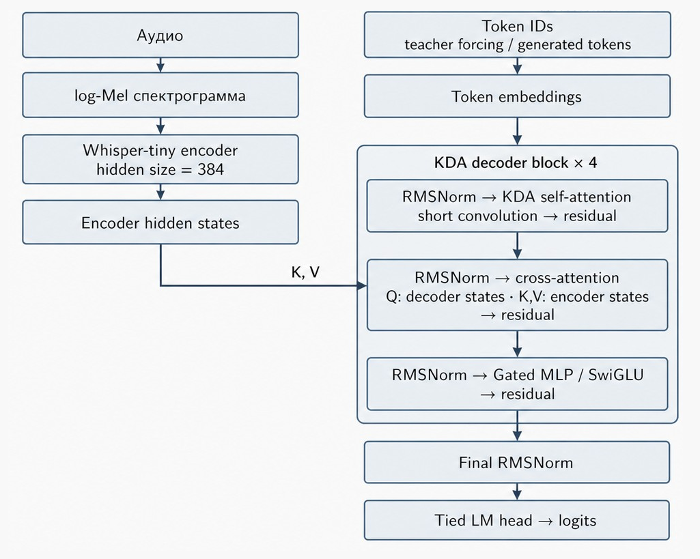
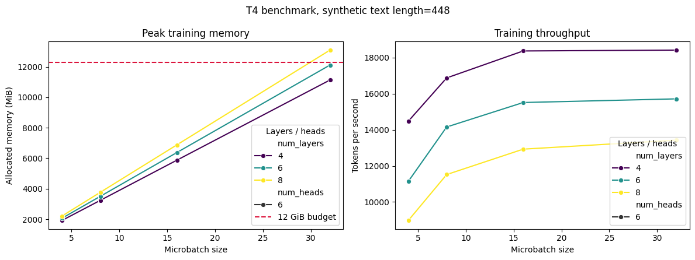

# Whisper-KDA

**Гибридная ASR-модель: предобученный энкодер Whisper-tiny и авторегрессионный декодер
на основе Kimi Delta Attention (KDA).**

Проект выполнен командой Летней проектной школы СПбГУ 2026 года
([SummerSchoolSPBU2026](https://github.com/SummerSchoolSPBU2026)) по теме
«Облегчение ASR-модели за счёт внедрения механизмов линейного внимания в декодер».
Целевое железо — одна NVIDIA Tesla T4.

[Идея](#идея) · [Статус](#статус) · [Архитектура](#архитектура) ·
[Результаты](#результаты) · [Установка](#установка) · [Использование](#использование) ·
[Ограничения](#ограничения-и-известные-проблемы)

## Идея

Декодер Whisper использует обычный causal self-attention: время вычислений растёт как
$O(T^2)$ от длины текста $T$, а при генерации KV-кэш хранит ключи и значения всех
предыдущих токенов. KDA — вариант линейного внимания с дельта-правилом обновления:
вместо KV-кэша хранится рекуррентное состояние фиксированного размера, а обучение
масштабируется как $O(T)$.

В Whisper-KDA self-attention декодера заменён на KDA, а cross-attention к
аудиопризнакам сохранён: без него декодер превратился бы в обычную языковую модель,
не зависящую от аудио. Поэтому модель целиком не линейная: стоимость cross-attention
по-прежнему пропорциональна произведению длины текста и длины аудио.

## Статус

Это исследовательский прототип.

| Этап | Состояние |
|---|---|
| Архитектура и реализация на PyTorch | готово |
| Функциональные проверки forward / backward | готово |
| Подбор конфигурации по памяти и скорости на T4 | готово |
| Text-only претрейн декодера | готово, 200 шагов |
| Сравнение скорости с Whisper-tiny | готово, на случайных весах |
| Подготовка данных и пайплайн обучения | готово, проверено smoke-запуском |
| Полное ASR-обучение и оценка WER / CER | **не выполнено** |

Качество распознавания (WER) пока не измерено: в `training/trainer.py` установлено
`max_steps=2`, то есть штатный запуск — это smoke-тест, а не обучение.

## Архитектура



Каждый блок декодера последовательно выполняет три подслоя:

1. **causal KDA self-attention** над уже известными токенами — реализация
   `KimiDeltaAttention` из [flash-linear-attention](https://github.com/fla-org/flash-linear-attention)
   с Triton-ядрами и режимом `chunk` для параллельного обучения;
2. **multi-head cross-attention**: query из декодера, key и value — выходы энкодера
   Whisper; карты внимания не сохраняются (`need_weights=False`);
3. **gated MLP (SwiGLU)**, совместимый с MLP оригинальной архитектуры KDA.

Конфигурация задаётся функцией `create_kda_config` в [model/model.py](model/model.py):

| Параметр | Значение |
|---|---|
| Энкодер | `openai/whisper-tiny`, по умолчанию заморожен |
| Скрытое состояние | 384 (совпадает с Whisper-tiny, проекция не нужна) |
| KDA-слоёв | 4 |
| Головы | 6 по 64 признака |
| Intermediate size MLP | 1024 |
| Short convolution | включена, ядро 4 |
| Нормализация | RMSNorm, $\varepsilon = 10^{-6}$ |
| Максимальная длина текста | 448 токенов |
| Embeddings и LM head | веса связаны |
| Словарь | берётся из токенизатора (в проекте BPE на 6390 токенов) |

При словаре 6390 токенов модель содержит около 20,5 млн параметров, а Whisper-tiny с тем
же словарём — около 20,3 млн. Модели сопоставимы по размеру.

Основные классы:

| Класс / функция | Назначение |
|---|---|
| `KDACrossAttentionBlock` | Блок декодера: KDA, cross-attention, Gated MLP |
| `KDACrossAttentionBackbone` | Embeddings, стек блоков и финальная нормализация |
| `KDACrossAttentionDecoder` | Декодер с LM head и кэшем состояния; без аудио работает как языковая модель (для претрейна) |
| `WhisperKDAModel` | Энкодер Whisper и KDA-декодер в одной encoder-decoder модели |
| `create_kda_config` | Единая воспроизводимая конфигурация; проверяет, что PAD, BOS и EOS различны |

`WhisperKDAModel.forward` принимает `input_features`, `attention_mask` и `labels`,
сам строит входы декодера сдвигом `labels` вправо и возвращает `Seq2SeqLMOutput`,
поэтому модель напрямую подключается к `Seq2SeqTrainer` из Hugging Face.
`load_pretrained_decoder` загружает веса претрейна декодера, проверяет совпадение
архитектуры и пропускает необученный cross-attention. `generate` реализует жадное
декодирование с рекуррентным состоянием KDA.

## Результаты

Все замеры выполнены в Google Colab / Kaggle на NVIDIA Tesla T4, FP16,
PyTorch 2.11 + CUDA 12.8, `transformers` 5.13.1, `flash-linear-attention` 0.5.2.

### Функциональные проверки

[benchmarks/kda-decoder.ipynb](benchmarks/kda-decoder.ipynb):

- отдельный KDA-декодер: корректная форма логитов, успешный backward, ненулевые
  градиенты в KDA и cross-attention, связанные embeddings и LM head;
- полная Whisper-KDA: forward и backward через новый декодер на случайных данных.

[benchmarks/decoder-pretrain-check.ipynb](benchmarks/decoder-pretrain-check.ipynb):
в режиме претрейна (без аудио) cross-attention не вызывается и не изменяется, а KDA, MLP
и embeddings обучаются.

[training/utils.py](training/utils.py) перед обучением проверяет, что генерация с
кэшем состояния даёт те же токены, что и генерация без кэша.

### Выбор конфигурации



Синтетический обучающий шаг с длиной текста 448 токенов для 4, 6 и 8 слоёв и
microbatch от 4 до 32. Четыре слоя дают наибольшую пропускную способность.
Восемь слоёв при microbatch 32 выходят за бюджет 12 GiB. Выбраны 4 слоя и стартовый
microbatch 16 (около 6 GiB): запас памяти нужен для реальных аудиобатчей, состояния
оптимизатора и генерации на валидации. Эффективный batch можно увеличивать через
gradient accumulation.

### Претрейн декодера

Декодер предварительно обучен как языковая модель на 1000 русскоязычных транскрипциях
FLEURS (900 train / 100 validation) с BPE-токенизатором команды. Cross-attention при этом
не обучался. Ноутбук — [decoder-pretrain/notebooks/results.ipynb](decoder-pretrain/notebooks/results.ipynb),
метрики — [decoder-pretrain/metrics/pretrain_metrics.json](decoder-pretrain/metrics/pretrain_metrics.json),
отчёт — [decoder-pretrain/docs/report.pdf](decoder-pretrain/docs/report.pdf).

| Показатель | До | После |
|---|---:|---:|
| Validation loss | 8,81 | 5,75 |
| Perplexity | 6708 | 314 |

200 шагов, эффективный batch 16, около 115 секунд обучения, 12,3 млн параметров декодера.

### Скорость генерации: Whisper-KDA и Whisper-tiny

Жадная генерация, batch 16, случайные веса, одинаковые синтетические log-Mel признаки
и общий словарь 6390 токенов. Длина — полная длина последовательности декодера.
Это сравнение скорости, а не качества распознавания.

| Длина | Whisper-KDA, токенов/с | Whisper-tiny без KV-кэша, токенов/с | Whisper-tiny с KV-кэшем, токенов/с |
|---:|---:|---:|---:|
| 64 | 897 | 1347 | 2993 |
| 128 | 807 | 1290 | 3196 |
| 256 | 808 | 1055 | 2529 |
| 448 | 826 | 764 | 3347 |

Источники: первые два столбца —
[benchmarks/benchmark-whisper-kda-vs-whisper-tiny.ipynb](benchmarks/benchmark-whisper-kda-vs-whisper-tiny.ipynb),
третий — отдельный прогон
[benchmarks/whisper_kda_vs_whisper_tiny_t4_batch16_whisper_cache_on.csv](benchmarks/whisper_kda_vs_whisper_tiny_t4_batch16_whisper_cache_on.csv)
(в нём Whisper-KDA показала 888–958 токенов/с).

Выводы:

- скорость генерации Whisper-KDA почти не зависит от длины текста, потому что размер
  её рекуррентного состояния фиксирован;
- Whisper-tiny без KV-кэша на каждом шаге заново обрабатывает весь префикс и замедляется
  с ростом длины; на 448 токенах Whisper-KDA быстрее него примерно в 1,08 раза;
- **со стандартным KV-кэшем Whisper-tiny быстрее Whisper-KDA примерно в 3–4 раза на
  всех проверенных длинах**. На длинах до 448 токенов выигрыша по скорости нет;
  поведение на более длинных последовательностях не измерялось;
- в режиме teacher forcing (как при обучении) Whisper-KDA на длине 448 тоже медленнее:
  133 мс против 113 мс на батч.

## Структура репозитория

```text
model/
├── model.py         # Архитектура Whisper-KDA, конфигурация, генерация
└── utils.py         # Сдвиг labels, пересчёт аудиомаски под длину энкодера
preprocessing/
├── prepare_dataset.py    # Распаковка архива и сборка HF Dataset из manifest
├── pipeline.py           # Нормализация, валидация, дедупликация, статистика, split
├── text_normalizer.py    # Нижний регистр, ё → е, пробелы и пунктуация
├── audio_preprocessor.py # Приведение аудио к 16 кГц
├── dataset_validator.py  # Проверка текста и длительности аудио
├── duplicate_remover.py  # Удаление дубликатов аудио и текста
├── dataset_statistics.py # Статистика по сплитам
└── dataset_splitter.py   # Train / validation / test 80 / 10 / 10
training/
├── pipeline.py                 # Точка входа обучения
├── trainer.py                  # Обёртка над Seq2SeqTrainer
├── dataset_feature_extractor.py# log-Mel признаки и токенизация
├── data_collactor.py           # Паддинг признаков и labels
├── metrics.py                  # WER и CER
├── utils.py                    # Проверка согласованности кэша генерации
├── manifest_5h_subset.jsonl    # Manifest 5-часового поднабора
└── colab_prepare_and_smoke.ipynb # Smoke-запуск пайплайна в Colab
pipelines/
└── whisper-tiny_baseline.py    # WER исходного Whisper-tiny на подготовленных данных
benchmarks/                      # Smoke-тесты, подбор конфигурации, сравнение с Whisper-tiny
decoder-pretrain/                # Ноутбук, метрики и отчёт претрейна декодера
docs/
└── architecture.png             # Схема архитектуры
```

## Данные

Для обучения подготовлен 5-часовой поднабор
[bond005/rulibrispeech](https://huggingface.co/datasets/bond005/rulibrispeech)
(Public Domain): 3142 записи длительностью от 2 до 12 секунд. Аудио и транскрипции
отфильтрованы по длительности и темпу речи и дедуплицированы по SHA-256 аудио и
хэшу текста. Поля manifest: `audio_filepath`, `duration`, `text`, `source`, `license`,
`audio_sha256`, `text_hash`.

В репозитории хранится только manifest
[training/manifest_5h_subset.jsonl](training/manifest_5h_subset.jsonl). Архив с аудио
`subset_5h.zip` (около 466 МБ) превышает лимит GitHub на размер файла и в git не
добавляется (указан в `.gitignore`). Перед подготовкой данных положите его в
`training/subset_5h.zip`.

## Установка

Нужны Python 3.12 и GPU с CUDA. Проверено на Tesla T4 (compute capability 7.5).
Файла зависимостей в репозитории нет; набор ниже взят из рабочих ноутбуков:

```bash
pip install torch  # сборка с CUDA под вашу систему
pip install "flash-linear-attention[cuda]==0.5.2" "transformers==5.13.1" \
  "datasets[audio]==3.6.0" "accelerate>=1.0.0" "evaluate>=0.4.0" \
  "jiwer>=3.0.0" "lion-pytorch>=0.2.3" "scikit-learn>=1.4.0" pandas
```

При первом запуске новой конфигурации KDA Triton компилирует ядра: несколько минут
CPU загружен, а GPU простаивает. Это не ошибка.

## Использование

### Модель в своём коде

`model/model.py` импортирует `utils` как модуль верхнего уровня, поэтому каталог
`model/` должен быть в `sys.path`:

```python
import sys
sys.path.insert(0, "model")

from transformers import PreTrainedTokenizerFast
from model import WhisperKDAModel, create_kda_config

tokenizer = PreTrainedTokenizerFast.from_pretrained("path/to/final_checkpoint")
config = create_kda_config(tokenizer=tokenizer)  # PAD, BOS и EOS должны различаться
model = WhisperKDAModel(config).cuda()

# Необязательно: веса text-only претрейна декодера.
model.load_pretrained_decoder("path/to/final_checkpoint")

# input_features и attention_mask — из WhisperFeatureExtractor.
generated_ids = model.generate(
    input_features=input_features,
    attention_mask=attention_mask,
    max_new_tokens=128,
)
text = tokenizer.batch_decode(generated_ids, skip_special_tokens=True)
```

Чекпойнт претрейна декодера вместе с BPE-токенизатором
(`kda_team_decoder_final_checkpoint.zip`) в git не хранится: каталог `checkpoints/`
указан в `.gitignore`. После распаковки путь к `final_checkpoint` передаётся и
токенизатору, и `load_pretrained_decoder`.

### Подготовка данных и обучение

Команды выполняются из корня репозитория.

```bash
# 1. Распаковать аудио и собрать Dataset → prepared_data/
python -c "from preprocessing.prepare_dataset import load_and_prepare_dataset; \
load_and_prepare_dataset(zip_path='training/subset_5h.zip', \
metadata_path='training/manifest_5h_subset.jsonl')"

# 2. Нормализация, валидация, дедупликация, split → preprocessed_dataset/
python -m preprocessing.pipeline

# 3. Базовая оценка исходного Whisper-tiny (WER)
python pipelines/whisper-tiny_baseline.py

# 4. Обучение Whisper-KDA (см. ограничения ниже)
python -m training.pipeline
```

Перед шагом 4 задайте в [training/pipeline.py](training/pipeline.py) `CHECKPOINT_PATH` —
путь к каталогу с токенизатором — и при необходимости раскомментируйте загрузку
претрейна декодера. Обучение использует оптимизатор Lion (lr $3 \cdot 10^{-5}$,
weight decay 0,1), batch 16, FP16, выбор лучшего чекпойнта по WER. Для полноценного
обучения уберите `max_steps=2` из [training/trainer.py](training/trainer.py).

## Ограничения и известные проблемы

- **Импорты обучения несовместимы с импортами модели.** `training/pipeline.py`
  импортирует `model.model`, а `model/model.py` — `from utils import ...`. Без `model/`
  в `sys.path` не находится `utils`, а с ним `model` разрешается в модуль `model.py`,
  и `model.model` не импортируется. Перед запуском `python -m training.pipeline` нужно
  исправить импорт в `model/model.py`.
- Генерация поддерживает только greedy decoding: beam search и sampling вызывают
  `NotImplementedError`, потому что перестановка состояния KDA между лучами не реализована.
- Энкодер Whisper по умолчанию заморожен, чтобы градиенты случайно инициализированного
  декодера не разрушили предобученные аудиопризнаки. Разморозка — `model.unfreeze_encoder()`.
- WER / CER Whisper-KDA не измерены, а сравнение скорости выполнено на случайных весах.
- Архив с аудио не входит в репозиторий, его нужно получить отдельно (см. [Данные](#данные)).

## Команда

| Участник | Зона ответственности |
|---|---|
| Кольцов А. Е. | Сбор, разметка и фильтрация данных |
| Попова М. А. | Предподготовка данных, пайплайн обучения |
| Кричман М. Е. | Стык энкодера и декодера, токенизатор |
| Тарасова Д. А. | Претрейн декодера |
| Кучин А. Д. | Архитектура модели, реализация на PyTorch, сравнение с Whisper |
| Сапегин П. Н. | Бенчмарки конфигураций KDA-блока, обучение |
| Кононенко А. А. | Оптимизация обучения |

Руководитель — Бушмелёв Ф. В., куратор — Демиденко Д. А.

## Лицензия

[MIT](LICENSE).
